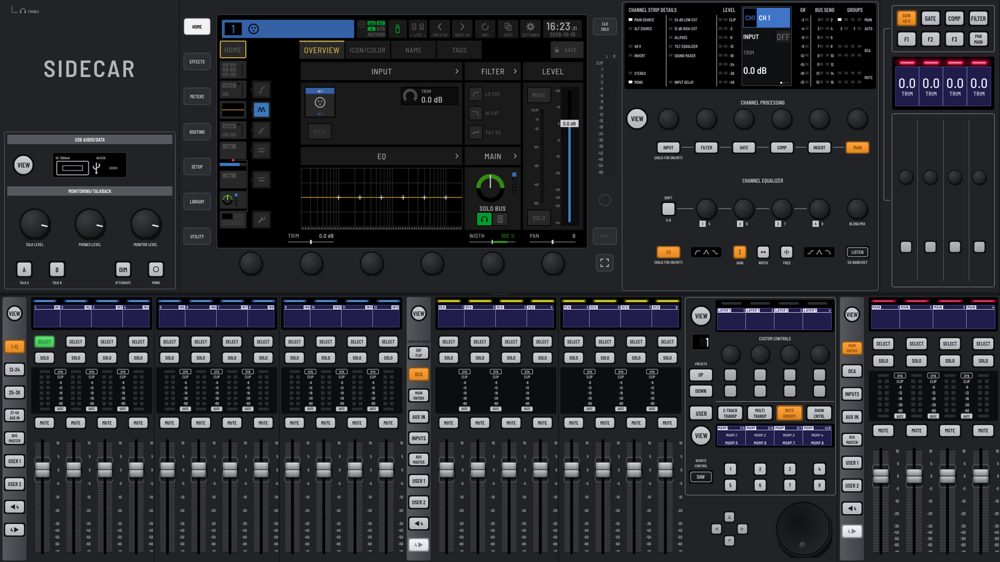
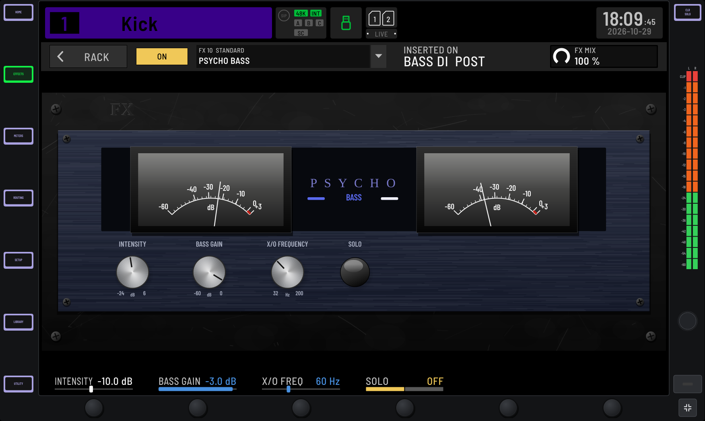
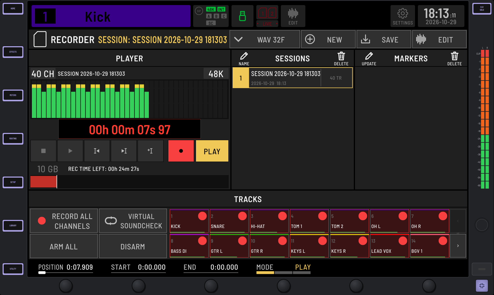

# Sidecar

Sidecar turns an ordinary computer and audio interface into a digital mixing console
for live sound, laid out and working like a **Behringer WING**. Inputs from your audio
interface are channels on the console; they feed buses, mains and matrices, and
anything can be sent to any hardware output. It runs on Windows, macOS and Linux.

> **Sidecar is an independent hobby project, made for fun and practice.** It is not
> affiliated with or endorsed by Behringer or Music Tribe; "WING" is their trademark.
> Sidecar tries its hardest to emulate the WING's interface and behaviour faithfully,
> but it is incomplete and can differ from the real console: the processing recreates
> the character of the WING's models, not Behringer's algorithms, and there is no
> remote preamp control, StageConnect, AES50 or Dante (see
> [Known limitations](#known-limitations); the notice shown at start-up, also under
> SETUP > GENERAL > ABOUT, lists the differences). Don't rely on it for a critical
> live show without testing it thoroughly first.

**Status: v0.1.0 beta**, the first public release. Expect rough edges, and please
[report what you find](#reporting-problems).

## Screenshots







## What it does

- **A WING console:** 40 input channels, 8 aux, 16 stereo buses, 4 stereo mains,
  8 matrices, 16 DCAs, 8 mute groups and 16 FX slots. More channels and buses can be
  added; the limit is your CPU.
- **The WING's processing**, in its order and with its process orders: input (trim,
  polarity, delay), filters, a gate and a dynamics slot with the WING's 32 dynamics
  models, the WING EQ and its analog EQ models, two inserts and sends with all of the
  WING's tap points.
- **An FX rack** with the WING's devices: 26 premium effects (reverbs, delays,
  chorus, pitch...), 32 standard effects (EQs, dynamics, amps, modulation...), 5
  channel strips, and VST3, AU (macOS) and LV2 (Linux) plugins.
- **The WING surface on screen:** three fader sections with layers, user layers and
  spill, the main display with the WING's screens (HOME, EFFECTS, METERS, ROUTING,
  SETUP, LIBRARY, VIEW, UTILITY), the channel strip, monitoring, 4-Channel and custom
  control sections. It resizes to any screen; the display can be shown on its own.
- **Shows, scenes and snippets** with recall scope, recall safes, fades and presets;
  scenes and snippets can be exported to files and imported into another show.
- **Multitrack recording** of up to 64 tracks, playback into the console (virtual
  soundcheck) and a built-in multitrack editor; the WING's **2/4-track USB recorder
  and player** using a folder on disk.
- **Monitoring and talkback:** phones and speakers paths with their own sources, EQ,
  delay and limiter, and two talk keys.
- **MIDI remote control and DAW remote control** (Mackie Control / HUI) as on the WING.
- **WING remote apps and files (experimental):** Sidecar answers the WING's network
  protocols (discovery, OSC and the native protocol), so WING remote software can
  find and drive it, and it imports and exports WING snapshots.
- **Built for stability:** a realtime engine in Rust with no allocations or locks on
  the audio thread, plugin faults contained, an audio device watchdog, autosave
  every 30 s and a safe mode after a crash.

The [user guide](docs/USER_GUIDE.md) describes every part in detail.

## System requirements

- **Windows** 10 or 11 (64-bit). ASIO drivers (your interface's own, or ASIO4ALL /
  FlexASIO) give the lowest latency; WASAPI also works.
- **macOS** 11 (Big Sur) or newer, CoreAudio.
- **Linux**, x86_64 with glibc 2.38 or newer, ALSA or JACK (or PipeWire's JACK
  layer) and X11.
- A multi-core CPU (strips are processed in parallel; a 40-channel console with
  processing on every channel uses a fraction of one core on a current machine),
  and a screen of at least 1366 x 768 (larger is better).
- An audio interface with as many inputs and outputs as you want to mix. Without one,
  the **Virtual (no hardware)** device lets you try the console.

## Download and install

Builds for all three platforms are attached to each release on the
[releases page](https://github.com/Audbol/Live-Daw/releases). See the release page
for the files of each version.

- **Windows:** download the zip, extract it anywhere and run `Sidecar.exe` (no
  runtime needed), or use the installer if the release offers one. Windows
  SmartScreen may warn about an unknown publisher the first time: choose *More info*
  > *Run anyway*.
- **macOS** (Apple silicon and Intel): open the disk image and drag `Sidecar.app` to
  *Applications*. The app is not signed or notarized by Apple, so the first time
  **right-click (or Ctrl-click) it and choose Open**, then Open again (on macOS 15 and
  newer: open it once, then *System Settings > Privacy & Security > Open Anyway*).
  Allow microphone access when asked: that is how macOS lets Sidecar read your audio
  interface's inputs.
- **Linux** (x86_64, glibc 2.38 or newer: Ubuntu 24.04+, Debian 13+, Fedora 39+ and
  similar): run the AppImage (`chmod +x Sidecar-*.AppImage`; it needs FUSE, or start
  it with `--appimage-extract-and-run`), or extract the tarball and run `Sidecar`;
  its `README-LINUX.txt` covers the runtime libraries, JACK / PipeWire and a menu
  entry. For low latency, add your user to the `audio` group and allow realtime
  scheduling (`/etc/security/limits.d/audio.conf`: `@audio - rtprio 95` and
  `@audio - memlock unlimited`), then log in again.

## First steps

1. **Choose the audio device:** on the main display, press **SETUP**, then **AUDIO**.
   The **DEVICE** field opens the driver (ASIO, WASAPI, CoreAudio, ALSA, JACK...),
   the device and the buffer size; **CLOCK RATE** sets the sample rate. On Windows,
   Sidecar picks ASIO automatically when an ASIO driver is installed. A buffer of 64
   to 256 samples suits live use.
2. **Patch the inputs:** press **ROUTING**. Pick a channel tile, then its source (the
   inputs of your interface). **+1 AUTO** moves on to the next channel. Under
   **OUTPUTS**, pick a hardware output, then the signal that feeds it (Main 1 L / R
   for your PA, for example).
3. **Mix:** pick layers on each fader section, **SELECT** a strip and edit it on the
   **HOME** screen and in the channel strip section; the six controls under the
   display follow the screen. Assign FX devices on **EFFECTS** and put them on the
   strips' inserts.
4. **Save:** **LIBRARY > SHOW** saves and opens shows (`Ctrl+S`, `Ctrl+O`); **SNAP**
   saves scenes, **GO** / **GO NEXT** recall them. The console is also autosaved every
   30 seconds and restored at the next start.
5. **Record:** the status bar's **LIVE** icon opens the recorder. **RECORD ALL
   CHANNELS** arms a track per input channel; **REC** on the recorder (or the MULTI
   TRANSP custom-control layer) starts recording into
   `Documents/Sidecar/Recordings`. **VIRTUAL SOUNDCHECK** plays the recording back
   through the console. `Ctrl+E` opens the multitrack editor.
6. **Connect WING apps (optional, experimental):** **SETUP > REMOTE > WING REMOTE >
   ENABLE** starts the WING network servers (UDP 2222 discovery, UDP 2223 OSC, TCP
   2222 native). Remote apps on the same network can then discover Sidecar under its
   console name. Allow Sidecar through your firewall. Tested with libwing's clients
   and the Bitfocus Companion WING module's OSC paths; WING Edit and WING Copilot
   have not been tried.

## Keyboard shortcuts

On macOS, use Cmd instead of Ctrl.

| Key | Action |
|---|---|
| F10 or Ctrl+Shift+F | Show only the main display (and back) |
| F11 | Full screen (and back) |
| Esc | Leave display-only, then full screen |
| Ctrl+S / Ctrl+Shift+S | Save the show / save it as |
| Ctrl+O | Open a show |
| Ctrl+G | Recall the next scene |
| Ctrl+E | Open / close the multitrack editor |
| Ctrl+L | Lock / unlock the surface |
| Ctrl+P | Save a screenshot of the display to `Documents/Sidecar/screens` |

Surface keys with a second function act on a long press (half a second) or a
right-click. The multitrack editor has its own keys (space, R, L, M, S, Ctrl+Z...;
see the [user guide](docs/USER_GUIDE.md#multitrack-recording)).

## Files and folders

- `Documents/Sidecar/`: recordings (`Recordings`), the USB recorder's folder (`USB`),
  the library (`Library`) and screenshots (`screens`).
- App settings (`Sidecar.settings`, including the plugin list) and the autosave:
  `%APPDATA%\Sidecar` on Windows; `~/Library/Application Support/Sidecar` (settings)
  and `~/Library/Sidecar` (autosave) on macOS; `~/Sidecar` (settings) and
  `~/.config/Sidecar` (autosave) on Linux.
- Folders from before the rename (`Live DAW`, `LiveDAW`) keep being used if they exist.

## Known limitations

This list matches the notice Sidecar shows at start-up.

- **Sound:** the channel processing and FX models recreate each unit's controls and
  character from the WING's parameter set, not Behringer's exact algorithms.
- **Hardware:** your audio interface's inputs and outputs take the place of the
  WING's. There is no StageConnect, AES50 or Dante, and no remote preamp control
  (HA REMOTE): source GAIN is digital and +48V is only stored.
- **Recording:** instead of the WING-LIVE SD cards, a multitrack recorder writes to a
  folder on disk (with an editor); the USB recorder uses a folder of your choice
  instead of a USB stick. The MP3 encoder is basic (constant bit rate, a simple
  masking model).
- **Plugins** (VST3, AU, LV2) run inside the mixer process, not in a sandbox: a plugin
  that crashes takes Sidecar down (safe mode then restores the show without plugins).
  There is no plugin delay compensation.
- **WING remote apps:** the WING network protocols cover 83.7 % of the WING 3.1
  parameter tree (the rest is stored but does nothing). WING Edit and WING Copilot
  have not been tried, and exported WING snapshots have not been loaded into a
  console.
- **MIDI and DAW remote control** (MCU / HUI) have not been tested with real hardware.
- **LIBRARY:** scene and snippet files are Sidecar's own (.lsnap / .lsnip), not the
  WING's .snap / .snip, and the CLIP tab plays its clip on the USB player.
- **Drawn but disabled:** the GPIO and SD functions of the custom controls (there is
  no GPIO socket or SD card), and settings that only make sense on the hardware.

## Reporting problems

Please open an [issue](https://github.com/Audbol/Live-Daw/issues/new/choose) with
your operating system, audio interface and driver, buffer size and sample rate, and
what happened. The event log (**SETUP > LOG** or **UTILITY**) shows device restarts,
plugin faults and errors; a screenshot of it helps. When Sidecar is started from a
terminal, the same messages are printed there. Security issues: see
[SECURITY.md](SECURITY.md).

## Building from source

You need:

- CMake 3.22 or newer
- a C++20 compiler: Visual Studio 2022 (MSVC), Xcode 14+ or GCC 11+ / Clang 14+
- a stable Rust toolchain, 1.83 or newer ([rustup](https://rustup.rs))
- Git (CMake fetches JUCE 8 and Corrosion at configure time)

The audio engine, DSP and sessions are written in Rust (`rust/`) and linked into the
JUCE app as a static library through [Corrosion](https://github.com/corrosion-rs/corrosion).

```bash
cmake -S . -B build -DCMAKE_BUILD_TYPE=Release
cmake --build build --config Release --parallel
ctest --test-dir build -C Release --output-on-failure   # C++ tests (engine, shows, stability, plugins, WING)

cd rust && cargo test --workspace                       # Rust tests
```

The app is built at `build/LiveDAW_artefacts/Release/` (`Sidecar.exe`, `Sidecar.app`
or `Sidecar`).

### Linux

```bash
sudo apt install build-essential pkg-config cmake git libasound2-dev libjack-jackd2-dev \
  libfreetype-dev libfontconfig1-dev libx11-dev libxcomposite-dev libxcursor-dev \
  libxext-dev libxinerama-dev libxrandr-dev libxrender-dev
```

(Package names are Debian / Ubuntu ones; other distributions have equivalents.)

### Windows

Build from a *Developer Command Prompt for VS 2022* (or let CMake find Visual
Studio):

```bat
cmake -S . -B build
cmake --build build --config Release
```

ASIO is built in: JUCE (8.0.11 and later) bundles the ASIO SDK, which Steinberg
relicensed under GPLv3 in October 2025, so there is nothing to download. The `.exe`
uses the static MSVC runtime, so it runs on any Windows 10/11 PC without the VC++
redistributable.

### macOS

Install Xcode (or its command-line tools), CMake and Rust, then build as above
(`-G Xcode` also works). The minimum deployment target is macOS 11.

### CMake options

| Option | Default | Meaning |
|---|---|---|
| `LIVEDAW_JUCE_DIR` | (empty) | Use a local JUCE checkout instead of fetching JUCE |
| `LIVEDAW_JUCE_TAG` | `8.0.15` | JUCE tag to fetch |
| `LIVEDAW_BUILD_TESTS` | `ON` | Build the `LiveDAWTests` test runner |
| `LIVEDAW_ASIO` | `ON` | Windows: ASIO support (JUCE's bundled SDK) |
| `LIVEDAW_ASIO_SDK_DIR` | (empty) | Windows: use another copy of the ASIO SDK |
| `LIVEDAW_VST2_SDK_DIR` | (empty) | Enable VST2 hosting with your own copy of the legacy VST2 SDK (not distributable) |
| `LIVEDAW_SANITIZE` | (empty) | GCC / Clang sanitizers, e.g. `address,undefined` or `thread` |

### Sanitizer builds (GCC / Clang)

```bash
cmake -S . -B build-asan -DCMAKE_BUILD_TYPE=Debug -DLIVEDAW_SANITIZE=address,undefined
cmake -S . -B build-tsan -DCMAKE_BUILD_TYPE=Debug -DLIVEDAW_SANITIZE=thread
# run the TSan tests with TSAN_OPTIONS=suppressions=tests/tsan.supp (the Rust part is not instrumented there)

# Rust engine under ThreadSanitizer (nightly):
cd rust && RUSTFLAGS=-Zsanitizer=thread cargo +nightly test -Zbuild-std --target x86_64-unknown-linux-gnu --workspace
```

### Developer tools

- `tools/wing/gen_tree.py` and `tools/wing/gen_models.py` regenerate the WING
  parameter tree (`rust/crates/livedaw-wing/data/wing_tree.bin`) and the processing
  model tables (`rust/crates/livedaw-dsp/src/wing/models_gen.rs`) from libwing's
  parameter sweep (`propmap.jsonl`).
- `tools/wing/libwing_tools.sh DIR` builds libwing's command-line clients and
  `tools/wing/oscprobe.rs`; then
  `LIBWING_TOOLS=DIR/tools/target/release cargo test -p livedaw-wing --test libwing`
  tests the WING remote servers against them.
- `tools/wing/check_companion.py` checks every OSC path the Bitfocus Companion WING
  module builds against a running server.
- `cargo run -p livedaw-wing --example wing_emulator` runs the WING protocols without
  the app; `--example wing_coverage` prints how much of the WING tree maps to the
  engine; `--example wing_snap` imports or exports a WING snapshot headlessly.

## Project layout

```
rust/crates/livedaw-dsp/      DSP: the WING models (filters, EQ models, 32 dynamics models), FX rack devices
rust/crates/livedaw-engine/   Realtime engine: WING topology, strips, sends, DCAs, mute groups, FX slots, solo, worker pool
rust/crates/livedaw-session/  Sessions: console state, Show > Scene > Snippet, fades, fader banks, show files
rust/crates/livedaw-wing/     WING parameter tree, its mapping onto the engine, the WING remote protocols, .snap/.show files
rust/crates/livedaw-recorder/ Multitrack recorder and the USB recorder / player (WAV, FLAC, AIFF, MP3 codecs, disk threads)
rust/crates/livedaw-ffi/      C ABI over the engine and model tables + C++ header (include/livedaw_engine.h)
src/engine/   C++ side: facades over the Rust code, audio devices, plugin hosting, MIDI and WING remote
src/daw/      Multitrack projects: tracks, clips, markers, undo, import / export
src/ui/       JUCE UI: the WING surface (fader sections, main display screens, channel strip, monitoring)
src/ui/daw/   The multitrack editor and the recorder screen
resources/    Barlow fonts (SIL Open Font License)
tools/wing/   Generators for the WING data, libwing test tools
tests/        C++ tests (run with ctest)
docs/         User guide and architecture notes
```

See [docs/ARCHITECTURE.md](docs/ARCHITECTURE.md) for the signal flow and the
realtime and threading design.

## Contributing

Bug reports, testing with real hardware and pull requests are welcome; see
[CONTRIBUTING.md](CONTRIBUTING.md). In short: keep the audio thread realtime-safe,
add tests, keep `cargo fmt`, `cargo clippy` and the C++ build warning-free, and never
add Behringer firmware, software, documents or artwork.

## Licence

Sidecar is free software: you can redistribute it and/or modify it under the terms
of the **GNU Affero General Public License, version 3**, as published by the Free
Software Foundation. It is distributed in the hope that it will be useful, but
WITHOUT ANY WARRANTY; without even the implied warranty of MERCHANTABILITY or
FITNESS FOR A PARTICULAR PURPOSE. See [LICENSE](LICENSE) for the full text.

The source code is at <https://github.com/Audbol/Live-Daw>. If you distribute
Sidecar, or modify it and let others use it over a network (for example through its
WING remote servers), the AGPLv3 asks you to offer them the corresponding source.

Sidecar is built on [JUCE](https://juce.com), which it uses under the AGPLv3. Windows
builds include the ASIO SDK (GPLv3). The UI fonts are Barlow (SIL Open Font
License 1.1), and the WING parameter data is derived from
[libwing](https://github.com/jerrythemaus/libwing) (Apache License 2.0). See
[THIRD_PARTY_NOTICES.md](THIRD_PARTY_NOTICES.md) for every component and its licence.

Behringer, WING and Music Tribe are trademarks of their owners. Sidecar is an
independent hobby project, not affiliated with or endorsed by Behringer or Music
Tribe, and contains none of their firmware, software or artwork.
